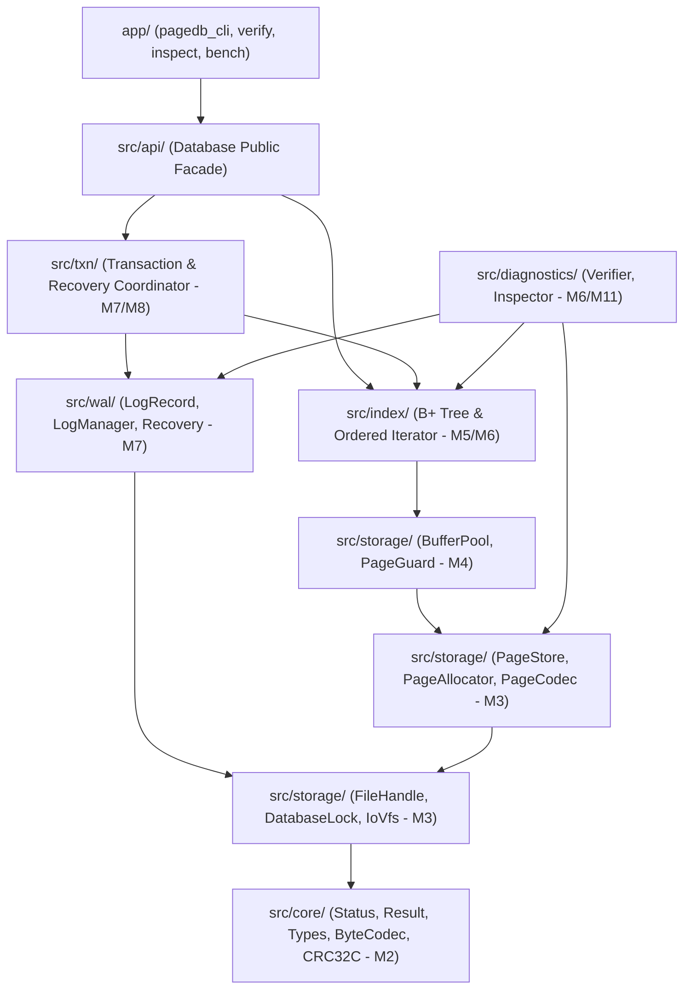

# PageDB Architecture

## 1. Module Hierarchy and Dependency Direction

PageDB is organized into strictly layered subsystems. Upper layers depend only on lower layers; circular dependencies are forbidden.

### Layer Responsibilities
1. **`core` (`status`, `types`, `byte_codec`, `crc32c`)**:
   - Zero I/O, zero OS state.
   - Strong value types (`PageId`, `Lsn`, `TxnId`), `Status`/`Result<T>`, checked integer arithmetic, explicit little-endian serialization, unsigned-byte comparator, and Castagnoli CRC32C.
2. **`storage` (`file_handle`, `page_codec`, `page_store`, `page_allocator`, `buffer_pool`, `page_guard`)**:
   - Owns file descriptors, advisory file locks (`pagedb.lock`), positional `pread`/`pwrite` loops, and narrow `IoVfs` fault-injection hooks.
   - Encodes/decodes 4096-byte pages (`Superblock`, `SlottedPage`), verifies CRC32C before parsing offsets, manages page allocation (`next_page_id`), and caches fixed-size frames in `BufferPool` with deterministic `PageGuard` pin management.
3. **`index` (`btree`, `btree_page`, `btree_iterator`)**:
   - Implements key-value lookup, insertion, variable-length splitting, deletion, redistribution, merging, root collapse, and forward leaf range scans.
   - Never performs raw file I/O; interacts exclusively with `BufferPool` and `PageGuard`.
4. **`wal` & `txn` (`log_record`, `log_manager`, `recovery`, `transaction`)**:
   - Enforces the no-steal and WAL-before-data durability protocols, before-image rollback, and redo recovery.
5. **`diagnostics` (`verifier`, `inspector`)**:
   - Read-only structural verification of page headers, slotted-page accounting, B+ tree key ordering, separator invariants, leaf depths, and allocator state.

## 2. Ownership and Lifetime Rules

- **`FileHandle`**: Move-only RAII wrapper around a POSIX file descriptor (`int fd_`). Closes the descriptor exactly once upon destruction or explicit `close()`.
- **`DatabaseLock`**: Move-only RAII wrapper around the `pagedb.lock` descriptor holding an exclusive `fcntl(F_SETLK)` advisory lock for the lifetime of the open database.
- **`BufferPool`**: Owns the preallocated array of 4096-byte frame buffers and their metadata (`page_id`, `pin_count`, `is_dirty`, `ref_bit`).
- **`PageGuard`**: Move-only RAII handle holding a single pin on a `BufferPool` frame. Decrements `pin_count` in its destructor or `release()`. Copy construction and copy assignment are deleted so a single guard can never double-unpin a frame.
- **No Raw Owning Pointers**: All dynamic ownership uses value types or `std::unique_ptr`. Caller code must never retain a `std::span` or reference into a frame's byte buffer after its `PageGuard` is released.

## 3. Thread-Safety Boundaries

- Through Milestone M9, `Database`, `BufferPool`, and `PageStore` are single-threaded components designed for deterministic single-process execution.
- Milestone M10 introduces explicit database-level reader/writer synchronization (`std::shared_mutex`) and thread-safe frame pinning audited under ThreadSanitizer (TSan).
